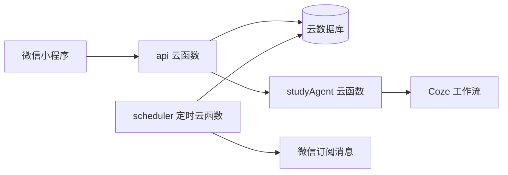

# 小觅书 · AI 学习规划助手

**[体验小程序](https://open.weixin.qq.com/sns/getexpappinfo?appid=wx1113286b7b45c357&path=#wechat-redirect)**

请使用微信打开体验入口；体验版是否可访问取决于微信平台的版本状态和体验成员权限。

原生微信小程序，将任务计划、专注计时、真实学习记录、统计复盘和 AI 学习建议串联为可确认、可撤销的学习闭环。

## 功能

- 今日任务卡片左右滑动、专注暂停与继续、学习记录编辑和长文本备注。
- 学习日历、日期任务维护、习惯打卡、一次性微信订阅与手机日历提醒。
- Excel 任务导入与学习记录导出，微信账号资料和账号数据隔离。
- 最近 7 天、30 天及自定义日期统计。
- Coze 学习导师：结合区间内时长、任务和备注提出学习与习惯计划。
- 建议预览编辑、事务导入、重复提交保护和保留已使用项的撤销。
- 分析历史与导入历史管理、超时错误提示及已保存结果恢复。

## 架构



统计由服务端计算，AI 只解释记录并生成建议。模型不能直接写数据库；建议经过日期、时长、预算和重复项校验，需用户确认后导入。撤销保留已完成、已修改或已有学习记录的项目。

| 目录 | 内容 |
| --- | --- |
| `miniprogram/` | 页面、样式、图标和本地同步逻辑 |
| `cloudfunctions/api/` | 业务入口、微信身份检查、数据隔离与事务 |
| `cloudfunctions/studyAgent/` | 导师提示词及 Coze 调用桥接 |
| `cloudfunctions/scheduler/` | 提醒检查及订阅消息发送 |
| `tests/` | 静态检查与模拟业务回归 |

## 快速开始

1. 使用微信开发者工具打开项目，将 `project.config.json` 中的 `touristappid` 换成你自己的 AppID。
2. 将 `miniprogram/app.js` 中的 `YOUR_CLOUD_ENV_ID` 换成自己的云环境 ID。
3. 按 [部署说明](docs/DEPLOYMENT.md) 配置并部署云函数。
4. 本地安装 Node.js 22 或更新的兼容版本，执行：

```sh
npm install
npm test
npm run check
```

GitHub Actions 执行相同的回归与静态检查。测试使用模拟数据，不调用付费模型、不发送微信消息。云端权限、真实模型响应及手机交互仍需在自己的环境验收。

## 公开源码范围

本仓库从最新项目生成独立的公开副本，保留核心功能源码，部署配置使用占位值。未包含真实密钥、生产云环境 ID、Coze 部署地址/项目编号、个人学习记录、个人开发者配置、部署截图和原项目 Git 历史。

README 顶部的体验 AppID 是体验入口必需的公开标识，经项目所有者授权保留；它不是密钥。请勿把生产配置写入源码或提交到 Git。

更多设计与限制见 [架构说明](docs/ARCHITECTURE.md) 与 [安全说明](SECURITY.md)。
